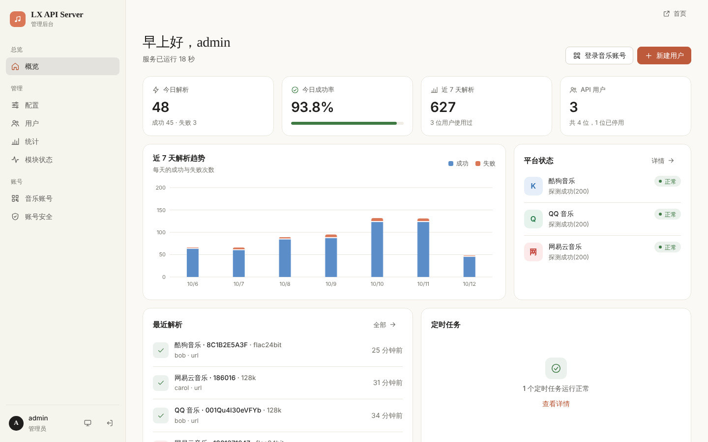
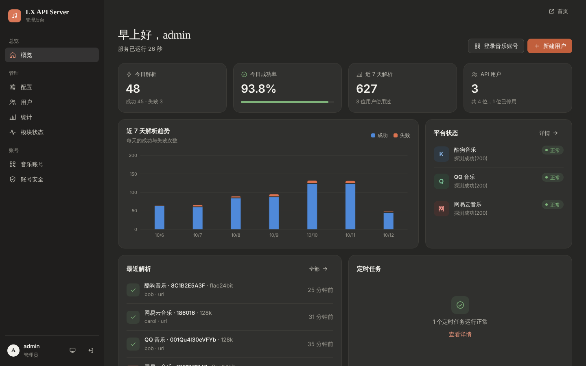
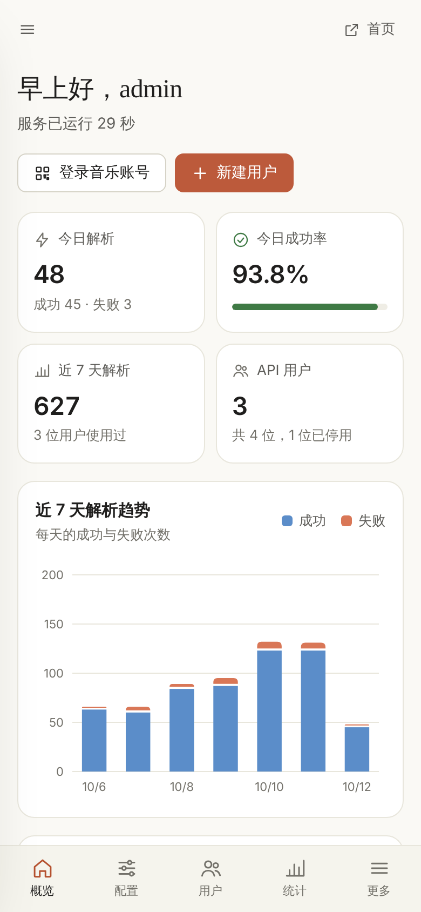
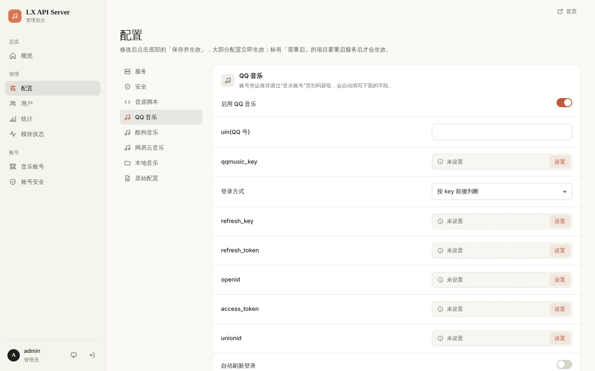
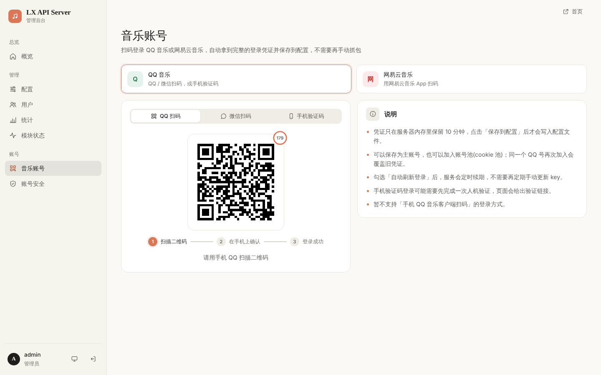

<div align="center">


# LX API Server

**自托管的多平台音乐解析服务，为 [LX Music](https://github.com/lyswhut/lx-music-desktop) 提供自定义音源**

[](https://github.com/nanci0406/lx-api-server/actions/workflows/ci.yml)


[功能特性](#功能特性) · [快速开始](#快速开始) · [接入 LX Music](#接入-lx-music) · [API 文档](#api-文档) · [管理后台](#管理后台) · [部署](#部署) · [常见问题](#常见问题)

</div>

---

LX API Server 是基于 [lx-music-api-server](https://github.com/MeoProject/lx-music-api-server) 改造的音乐解析后端。它把 QQ 音乐、酷狗音乐、网易云音乐的歌曲解析为可播放的链接，通过“用户名 + Key”对外提供接口，并自带一个适配电脑和手机的 Web 管理后台。扫码登录平台账号、管理用户、查看解析统计、监控账号状态都可以在浏览器里完成，不再需要手动抓包和修改配置文件。

<p align="center">
  
</p>

## 功能特性

**解析服务**
- 支持 QQ 音乐、酷狗音乐、网易云音乐，最高可解析无损、Hi-Res、杜比全景声等音质（视账号权益而定）
- 按用户分配 Key，可随时停用、重置；接口支持全局 / 单 IP 限速、IP 封禁、Host 白名单
- 一键生成 LX Music 自定义音源脚本，用户导入链接即可使用
- 单账号与账号池（cookie 池）两种模式，账号池按请求随机分配账号

**账号管理**
- 后台扫码登录：QQ 音乐支持 QQ 扫码、微信扫码、手机验证码，网易云支持 App 扫码，登录后自动写入配置
- 自动刷新登录（保活）：QQ 音乐、酷狗、网易云的凭证按周期自动续期，新凭证自动写回配置
- 刷新失败按 1 分钟 → 5 分钟 → 30 分钟 → 2 小时退避重试，并在后台标出异常的任务和平台

**管理后台**
- 单页应用，适配电脑和手机，支持浅色 / 深色主题，不依赖任何外部 CDN，内网可离线使用
- 共七个页面：概览、配置、用户、统计、模块状态、音乐账号、账号安全；配置修改后热重载，立即生效
- 解析统计：按天趋势、平台分布、用户排行，解析记录可按用户 / 平台 / 结果筛选，过期记录自动清理

**安全**
- 管理员密码使用加盐 scrypt 存储；登录失败限速；会话空闲 4 小时、登录满 24 小时后过期
- 后台写操作仅接受 JSON 请求并校验来源（防 CSRF），Cookie 为 `HttpOnly` + `SameSite=Strict`，页面启用严格 CSP
- 日志中不记录用户 Key，状态接口不返回任何凭证

## 界面预览

| 深色模式 | 手机端 |
| :---: | :---: |
|  |  |

| 配置（分组表单、校验、热重载） | 音乐账号（扫码登录） |
| :---: | :---: |
|  |  |

> 截图中的用户和解析记录为演示数据。

## 快速开始

### 环境要求

- Python 3.10 及以上（CI 在 3.10 与 3.12 上测试）
- 能访问各音乐平台接口的网络；服务器在中国大陆以外时，部分平台可能需要配置国内代理

### 安装与启动

```bash
git clone https://github.com/nanci0406/lx-api-server.git
cd lx-api-server
pip install -r requirements.txt
python main.py
```

服务默认监听 `0.0.0.0:9763`。首次启动会在当前目录生成配置文件和数据库（见[数据与文件](#数据与文件)）。

### 首次登录后台

打开 `http://<服务器地址>:9763/admin`，使用管理员账号登录：

- 用户名：`admin`
- 密码：首次启动时随机生成，打印在启动日志中

也可以在首次启动时通过环境变量指定管理员账号：

```bash
LX_ADMIN_USERNAME=admin LX_ADMIN_PASSWORD='your-strong-password' python main.py
```

> 环境变量只在管理员账号尚不存在时生效。登录后请在“账号安全”页修改密码。

### 三步开始使用

1. **登录平台账号**：在“音乐账号”页扫码登录 QQ 音乐或网易云音乐，保存时勾选“自动刷新登录”
2. **创建用户**：在“用户”页新建用户，系统会生成一个随机 Key
3. **分发音源**：把用户名和 Key（或音源脚本链接）发给使用者

## 接入 LX Music

开启 `common.allow_download_script`（默认开启）后，每位用户都有一个专属的音源脚本地址：

```text
http://<服务器地址>:9763/script?key=<用户的 Key>
```

在 LX Music 中打开 **设置 → 自定义源 → 在线导入**，粘贴上述地址即可。脚本中已自动填好服务器地址、用户名和 Key。也可以在后台“用户”页直接复制脚本链接，或在公开首页 `/` 输入 Key 生成。

脚本名称、版本、更新提示以及各平台开放的音质，可在后台“配置 → 音源脚本”中修改。

## API 文档

### 鉴权

`security.key.enable` 开启时（默认开启），解析接口需要在请求头中携带用户名和 Key：

```http
X-Request-User: alice
X-Request-Key: <用户的 Key>
```

### 接口

| 方法 | 路径 | 说明 |
| --- | --- | --- |
| `GET` | `/url/{source}/{songId}/{quality}` | 获取播放链接 |
| `GET` | `/lyric/{source}/{songId}` | 获取歌词 |
| `GET` | `/info/{source}/{songId}` | 获取歌曲信息 |
| `GET` | `/mv/{source}/{mvId}` | 获取 MV 信息与播放地址 |
| `GET` | `/search/kg/song?query=…&page=1&size=20` | 搜索歌曲（仅酷狗） |
| `GET` | `/script?key=…` | 下载 LX Music 音源脚本 |

各平台支持的方法：

| 平台 | `source` | `songId` | url | lyric | info | mv | search |
| --- | --- | --- | :---: | :---: | :---: | :---: | :---: |
| QQ 音乐 | `tx` | songmid | ✓ | ✓ | ✓ | ✓ | |
| 酷狗音乐 | `kg` | hash | ✓ | ✓ | ✓ | ✓ | ✓ |
| 网易云音乐 | `wy` | 歌曲 ID | ✓ | | | | |

### 音质

| `quality` | 说明 | QQ 音乐 | 酷狗 | 网易云 |
| --- | --- | :---: | :---: | :---: |
| `128k` | 标准 | ✓ | ✓ | ✓ |
| `192k` | 较高 | | | ✓ |
| `320k` | 高品质 | ✓ | ✓ | ✓ |
| `flac` | 无损 | ✓ | ✓ | ✓ |
| `flac24bit` | Hi-Res | ✓ | ✓ | ✓ |
| `dolby` | 杜比全景声 | ✓ | | ✓ |
| `sky` | 沉浸环绕声 | | | ✓ |
| `master` | 母带 | ✓ | ✓ | ✓ |

实际能拿到的音质取决于所用账号的会员权益。

### 示例

```bash
curl -H "X-Request-User: alice" \
     -H "X-Request-Key: <用户的 Key>" \
     "http://127.0.0.1:9763/url/tx/0039MnYb0qxYhV/320k"
```

### 响应格式

所有接口返回 JSON：

```json
{
  "code": 0,
  "msg": "success",
  "data": "https://…",
  "extra": {
    "cache": false,
    "quality": { "target": "320k", "result": "320k" },
    "expire": { "time": 1760000000, "canExpire": true }
  }
}
```

| `code` | 含义 |
| :---: | --- |
| `0` | 成功 |
| `1` | 未知的平台或不支持的方法；IP 已被封禁；请求来源不被允许 |
| `2` | 平台返回获取失败（如无版权、账号无权限），原因见 `msg` |
| `4` | 平台已在配置中关闭，或服务内部错误 |
| `5` | 触发限速 |
| `6` | 缺少用户名 / Key、Key 验证失败、请求参数错误或资源不存在 |

## 管理后台

后台地址为 `/admin`，所有页面都由前端路由处理，前端只调用 `/api/admin/*` JSON 接口。

| 页面 | 地址 | 功能 |
| --- | --- | --- |
| 概览 | `/admin` | 今日与近 7 天解析量、成功率、趋势图、平台状态、最近解析、定时任务状态 |
| 配置 | `/admin/config` | 按分组编辑常用配置并校验；从属项随开关联动；密钥只显示“已设置 / 末尾几位”；“原始配置”可直接编辑 `config.yml`，保存前自动备份，加载失败自动恢复 |
| 用户 | `/admin/users` | 新建、停用、删除用户，重置 Key，复制音源脚本链接，查看每位用户的解析次数与成功率 |
| 统计 | `/admin/stats` | 今天 / 近 7 天 / 近 30 天的趋势、平台分布、用户排行与可筛选的解析记录 |
| 模块状态 | `/admin/health` | 各平台可用性与凭证有效性，定时任务的执行情况；可立即检查、立即执行任务 |
| 音乐账号 | `/admin/music-login` | 扫码 / 验证码登录 QQ 音乐与网易云音乐，保存为主账号或加入账号池 |
| 账号安全 | `/admin/account` | 修改管理员密码、退出其他设备上的登录 |

公开首页 `/` 展示各平台状态，用户可在首页用自己的用户名和 Key 在线解析单曲、生成音源脚本链接。首页只显示笼统的状态，账号细节仅管理员可见。

## 平台账号

### 扫码登录

在“音乐账号”页选择平台：

- **QQ 音乐**：QQ 扫码、微信扫码，或手机号 + 短信验证码（首次可能需要在浏览器中完成一次人机验证，页面会给出链接）
- **网易云音乐**：使用网易云音乐 App 的“扫一扫”

登录成功后可选择：

- **保存为主账号**：写入 `module.tx.user` / `module.wy.user`
- **加入账号池**：写入 `module.cookiepool.tx` / `module.cookiepool.wy`，同一账号再次加入会覆盖旧凭证

勾选“自动刷新登录”会同时开启该账号的保活任务，保存后配置立即热重载。保存之前，登录得到的凭证只保存在服务端内存中（最长 10 分钟），任何接口都不会返回凭证本身。

### 手动配置

也可以在“配置”页或 `config.yml` 中手动填写：

| 平台 | 配置项 | 说明 |
| --- | --- | --- |
| QQ 音乐 | `module.tx.user` | `uin`、`qqmusic_key`，以及刷新所需的 `refresh_key`、`refresh_token` 等 |
| 酷狗音乐 | `module.kg.user` | `userid`、`token`、`mid`（抓包 `/v5/url` 请求获得） |
| 网易云音乐 | `module.wy.user.cookie` | 完整 Cookie，需包含 `MUSIC_U` |

### 自动刷新登录

开启各平台的 `refresh_login.enable` 后，服务会按 `refresh_login.interval`（秒）周期续期，刷新返回的新凭证自动写回配置：

```yaml
module:
  tx:
    user:
      uin: "123456"
      qqmusic_key: "Q_H_L_…"
      refresh_key: "…"
      refresh_login:
        enable: true
        interval: 86000
```

- **QQ 音乐**：按保存的 `login_type`（1 微信、2 QQ）选择刷新方式，没有时按 `qqmusic_key` 前缀判断
- **网易云音乐**：刷新请求与 [NeteaseCloudMusicApi](https://www.npmjs.com/package/NeteaseCloudMusicApi) 一致；返回 `301` 表示 `MUSIC_U` 已失效，需要重新扫码登录
- **酷狗音乐**：刷新 `token`；概念版（appid 3116）还支持每日自动签到

启动日志会列出已注册的定时任务，例如 `scheduler loaded 2 task(s): qqmusic_refresh_login, parse_logs_cleanup`。连续失败的任务会显示在“模块状态”页，对应平台标记为“降级”。

### 账号池

`common.cookiepool` 为 `true` 时，每次请求从 `module.cookiepool.<平台>` 中随机选择一个账号，单账号配置会被忽略。账号池中每个账号可以单独设置 `refresh_login`。

## 配置

配置文件位于 `config/config.yml`，首次启动时自动生成。常用配置项都可以在后台“配置”页修改并热重载；标有“需重启”的项目（如监听地址、端口）需要重启服务才会生效。

| 配置项 | 默认值 | 说明 |
| --- | --- | --- |
| `common.hosts` / `common.ports` | `0.0.0.0` / `9763` | 监听地址与端口 |
| `common.ssl_info.is_https` | `false` | 通过 HTTPS 反向代理访问时设为 `true` |
| `common.reverse_proxy.real_ip_header` | `X-Real-IP` | 反向代理传递真实 IP 的请求头 |
| `common.proxy` | 关闭 | 出站请求使用的 HTTP / HTTPS 代理 |
| `common.cookiepool` | `false` | 账号池模式 |
| `common.allow_download_script` | `true` | 是否开放 `/script` 音源脚本下载 |
| `common.parse_log_retention_days` | `30` | 解析记录保留天数，`0` 为不清理 |
| `security.key.enable` | `true` | 解析接口是否需要用户名和 Key |
| `security.rate_limit.global` / `.ip` | `0` | 全局 / 单 IP 两次请求的最小间隔（秒），`0` 为不限制 |
| `security.admin_origin_check` | `true` | 后台写操作的来源校验 |
| `module.<平台>.enable` | `true` | 是否启用该平台 |

## 部署

### systemd

```ini
# /etc/systemd/system/lx-api-server.service
[Unit]
Description=LX API Server
After=network-online.target

[Service]
WorkingDirectory=/opt/lx-api-server
ExecStart=/usr/bin/python3 main.py
Restart=on-failure
RestartSec=5

[Install]
WantedBy=multi-user.target
```

```bash
systemctl daemon-reload
systemctl enable --now lx-api-server
```

### Nginx 反向代理（HTTPS）

```nginx
server {
    listen 443 ssl http2;
    server_name music.example.com;

    ssl_certificate     /path/to/fullchain.pem;
    ssl_certificate_key /path/to/privkey.pem;

    location / {
        proxy_pass http://127.0.0.1:9763;
        proxy_set_header Host $host;
        proxy_set_header X-Real-IP $remote_addr;
        proxy_set_header X-Forwarded-Host $host;
    }
}
```

使用 HTTPS 反向代理时，请把 `common.ssl_info.is_https` 设为 `true`，这样后台 Cookie 会带上 `Secure` 标记，生成的音源脚本也会使用 `https` 地址。代理需要透传原始的 `Host`，否则后台写操作会因来源校验失败而被拒绝。

### 升级

```bash
git pull
pip install -r requirements.txt
systemctl restart lx-api-server
```

## 数据与文件

运行时生成的文件均已在 `.gitignore` 中忽略：

| 路径 | 内容 |
| --- | --- |
| `config/config.yml` | 主配置文件（含平台账号凭证，请妥善保管） |
| `config/data.db` | 封禁列表、请求时间等运行数据 |
| `config/tx_device.json` | QQ 音乐验证码登录使用的设备信息 |
| `app.db` | 用户、管理员、解析记录、模块状态 |
| `cache.db` | 解析结果与请求缓存 |
| `logs/` | 运行日志 |

从旧版本升级时，目录中的 `users.db` 会在启动时自动迁移到 `app.db`。

## 安全建议

- 部署后立即修改默认管理员密码（至少 8 位）
- 生产环境建议放在 HTTPS 反向代理之后，并保持 `security.key.enable` 开启
- `config/config.yml` 与 `app.db` 包含账号凭证和用户 Key，不要提交到公开仓库，也不要随意分享
- 用户 Key 等同于账号密码，泄露后请在“用户”页重置
- 后台“原始配置”页会显示全部凭证明文，请勿截图外传

## 常见问题

<details>
<summary><b>QQ 扫码后提示“获取登录凭据失败：没有拿到 p_skey”</b></summary>

请先确认服务已更新到最新版本并已重启。新版本会在提示末尾附上每次请求的状态码和跳转去向，例如 `(HTTP 302，跳转到 …)`，可以据此判断是否是 QQ 要求了额外的安全验证。也可以改用手机验证码登录。
</details>

<details>
<summary><b>网易云刷新登录提示 code 301</b></summary>

`MUSIC_U` 已经失效，刷新无法恢复。请在“音乐账号”页重新扫码登录。
</details>

<details>
<summary><b>后台保存时提示“请求来源校验失败”</b></summary>

通常是反向代理改写了 `Host`。请让代理透传原始 `Host`（或设置 `X-Forwarded-Host`），或者把 `security.admin_origin_check` 设为 `false`。
</details>

<details>
<summary><b>服务器在海外，部分平台解析失败</b></summary>

服务启动时会自动检测服务器位置，在海外时自动启用 IP 伪装（`common.fakeip`）。如果仍然失败，请在 `common.proxy` 中配置国内代理。
</details>

<details>
<summary><b>网易云扫码提示缺少依赖 qrcode</b></summary>

升级后需要重新执行 `pip install -r requirements.txt` 并重启服务。
</details>

## 开发

```text
lx-api-server
├── main.py           # 入口：HTTP 服务、中间件、解析接口
├── common/           # 配置、数据库、调度器、HTTP 客户端、鉴权与统计服务
├── modules/          # 各平台实现：tx（QQ 音乐）、kg（酷狗）、wy（网易云）
├── webui/            # 管理后台：JSON 接口（api_admin / api_public）与前端静态资源
├── tests/            # 单元测试
└── docs/images/      # README 截图
```

```bash
# 语法检查
python -m compileall -q common modules main.py webui

# 运行测试（在临时目录中运行，不会改动仓库内的配置和数据库）
python -m unittest discover -s tests
```

每次推送和 Pull Request 都会通过 GitHub Actions 在 Python 3.10 与 3.12 上运行全部测试。

## 致谢

- [lx-music-api-server](https://github.com/MeoProject/lx-music-api-server)：本项目的上游，提供了解析服务的基础框架；QIMEI 与设备信息的实现也参考了该项目
- [YAQMC/qm-api-rs](https://github.com/YAQMC/qm-api-rs)、[qqmusic-api-python](https://github.com/l-1124/QQMusicApi)：QQ 音乐登录协议参考（代码为独立实现）
- [NeteaseCloudMusicApi](https://www.npmjs.com/package/NeteaseCloudMusicApi)：网易云音乐扫码登录与刷新登录参考
- [LX Music](https://github.com/lyswhut/lx-music-desktop)：优秀的开源音乐播放器

## 免责声明

本项目仅供学习与技术交流使用，请勿用于商业用途。通过本项目获取的音乐内容，版权归各音乐平台及版权方所有，请在合理范围内使用，并支持正版音乐。使用本项目产生的一切后果由使用者自行承担。

## 许可证

本项目沿用上游项目的 [MIT](https://opensource.org/licenses/MIT) 许可证，详见各源文件头部的许可声明。
